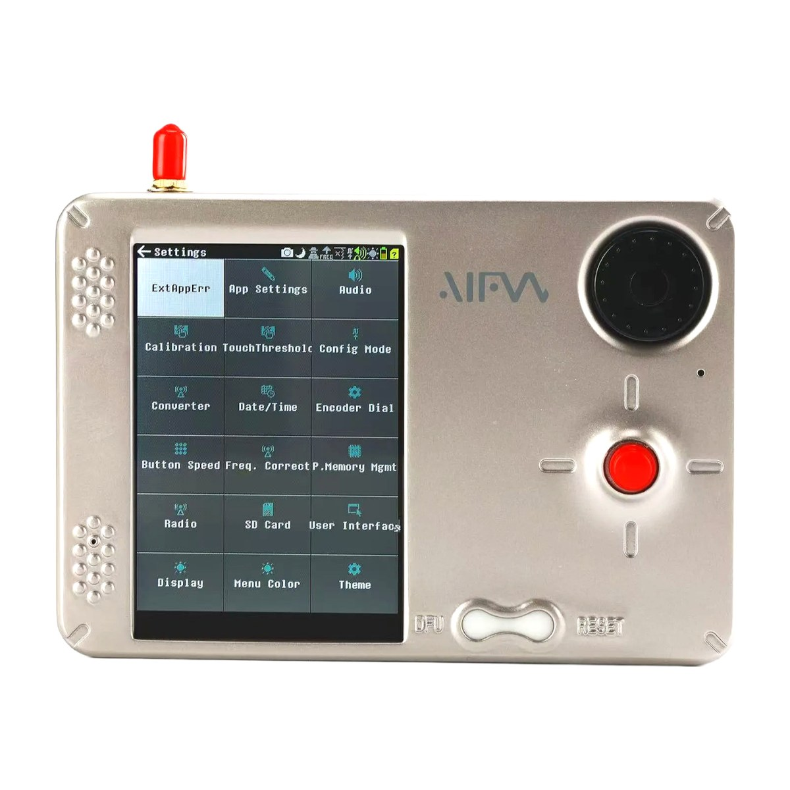
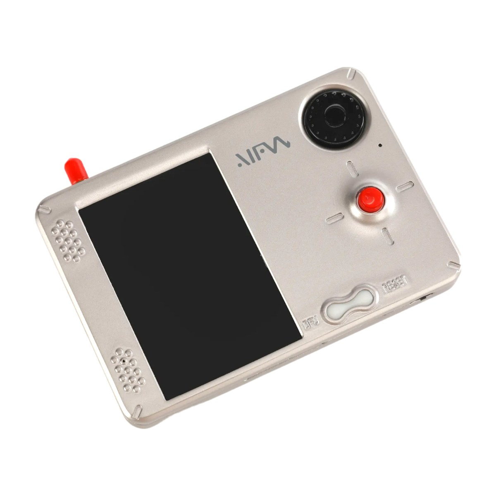

# PortaRF

Hardware design files and firmware source code for the **OpenSourceSDRLab PortaRF**, which combines the HackRF One and the PortaPack H4M on a single board: a portable 1 MHz – 6 GHz software-defined radio that receives and transmits without a computer, running a customised Mayhem firmware.

  
  

## Product link

<https://opensourcesdrlab.com/products/portarf>

## About the device

- Radio: HackRF One R10 design (LPC4320 MCU, MAX2837 transceiver, RFFC5072 mixer, MAX5864 ADC/DAC), 1 MHz – 6 GHz, half duplex
- PortaPack H4M functions on the same board: 4.0-inch IPS resistive touch screen, WM8731 audio codec, speaker and microphone, microSD card slot
- 2 MB SPI flash (W25Q16) instead of 1 MB, for larger firmware images
- 3000 mAh lithium battery with charger (BQ24075), fuel gauge (MAX17055) and protection board
- Rotary knob and gamepad-style directional keys
- Expansion slot with a board-to-board connector for the **AI MDK** voice-assistant board ([AI-MDK repository](https://github.com/OpenSourceSDRLab/AI-MDK))
- Light-guide LED status indicators, USB-C for charging, HackRF mode and firmware updates
- Firmware: based on Mayhem v2.3.2 with PortaRF changes (2 MB flash image, MP3 player, AI MDK voice commands, low-power mode, ESP32 module tools)

## Quick start

1. Download `mayhem_v2.3.2_COPY_TO_SDCARD.zip` and `portapack-mayhem_OCI.ppfw.tar` from the [Releases](../../releases) page. Unzip the first file to the root of a FAT32 microSD card and copy the `.ppfw.tar` file into the card's `FIRMWARE` folder.
2. Insert the card into the PortaRF and switch it on.
3. To update the firmware, open **Utilities > Flash Utility** and select `portapack-mayhem_OCI.ppfw.tar`, or flash `portapack-mayhem-firmware.bin` from a computer.

The full steps are in the **[Quick Start Guide](docs/Quick-Start-Guide.md)** ([PDF](docs/Quick-Start-Guide.pdf)).

## Repository layout

| Path | Contents |
|---|---|
| `hardware/PortaRF/` | PortaRF R1 schematic (PDF), PCB layout (EasyEDA JSON) and Gerber/drill files |
| `firmware/` | Mayhem firmware source code with the PortaRF changes |
| `hackrf/` | HackRF firmware and host tools source code with the PortaRF changes |
| `sdcard/` | Files copied to the microSD card (applications data, samples, frequency lists) |
| `hardware/portapack_*`, `flashing/`, `docs/` (except the guide) | Files inherited from the Mayhem project |
| `docs/` | PortaRF Quick Start Guide (Markdown and PDF) |
| `images/` | Product photos |

## Downloads (Releases)

Firmware and SD-card files are attached to the [Releases](../../releases) page:

| File | Contents |
|---|---|
| `mayhem_v2.3.2_FIRMWARE.zip` | `portapack-mayhem-firmware.bin` (2 MB), HackRF recovery firmware and Windows flashing scripts, tools and drivers |
| `mayhem_v2.3.2_COPY_TO_SDCARD.zip` | Complete microSD card contents (applications, data files and the ADS-B world map) |
| `mayhem_v2.3.2_COPY_TO_SDCARD-no-world-map.zip` | The same without the ADS-B world map (smaller download) |
| `portapack-mayhem_OCI.ppfw.tar` | PortaRF firmware update file for **Utilities > Flash Utility** |
| `SHA256SUMS.txt` | SHA-256 checksums of the files above |

Check a download with `shasum -a 256 -c SHA256SUMS.txt` (macOS / Linux) or `certutil -hashfile <file> SHA256` (Windows).

## Videos

- PortaRF – a new HackRF PortaPack combo in one single board: <https://www.youtube.com/watch?v=fDFtJgR6TcE>
- PortaRF deep dive: <https://www.youtube.com/watch?v=B1F76LqbRrY>
- HackRF PortaPack evolved? This is PortaRF: <https://www.youtube.com/watch?v=LNKeIju5pRY>
- PortaRF – AI voice-assisted device control: <https://www.youtube.com/watch?v=Xrx7OxZS-OY>
- PortaRF quick look: <https://www.youtube.com/watch?v=y4wdKojJfC0>
- News report: [RTL-SDR.com](https://www.rtl-sdr.com/two-youtube-reviews-of-the-new-portarf-a-new-hackrf-portapack-combo/)

## Licence

The firmware is based on the Mayhem firmware and HackRF and is licensed under the GNU GPL (see [LICENSE](LICENSE), [LICENSE.GPL-2.0-or-later](LICENSE.GPL-2.0-or-later) and `hackrf/COPYING`). The PortaRF hardware files, documentation and photos created by OpenSourceSDRLab are released under the [Apache License 2.0](LICENSE.Apache-2.0). See [NOTICE.md](NOTICE.md) for details.

## Support

- Email: support@opensourcesdrlab.com
- Forum: <https://forum.opensourcesdrlab.com>
- Discord: <https://discord.gg/nnxY6DkmvT>
- Blog and user manuals: <https://blog.opensourcesdrlab.com>

---
© 2026 OpenSourceSDRLab. All rights reserved. · <a href="https://www.opensourcesdrlab.com">www.opensourcesdrlab.com</a>
