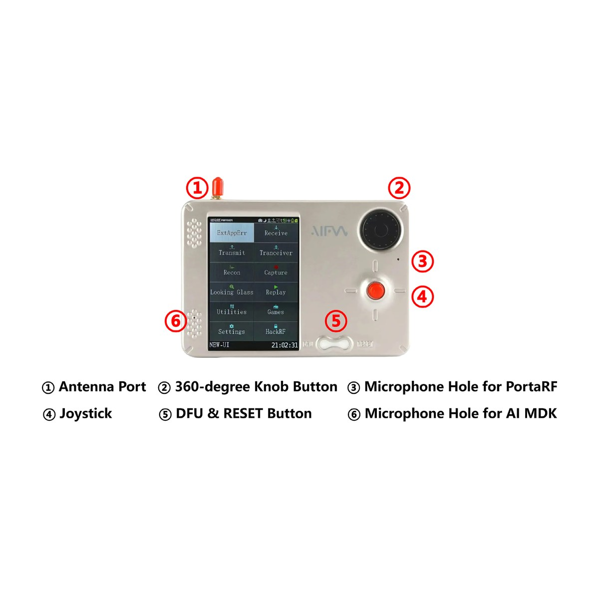
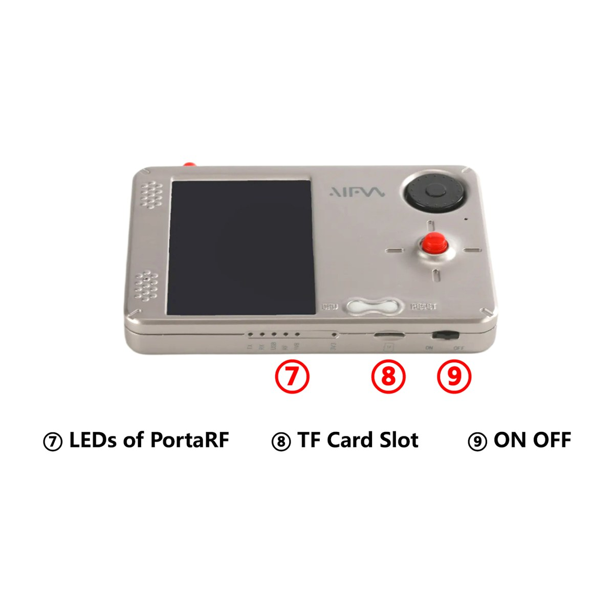
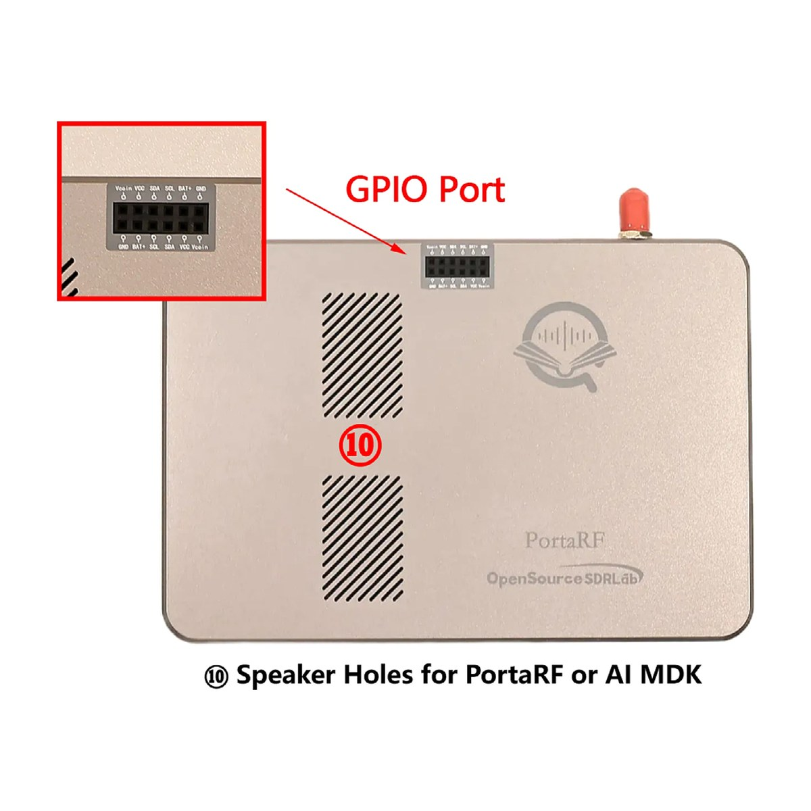

<!-- ossl:header -->

# PortaRF Quick Start Guide

| Product | Document | Version | Date |
|---|---|---|---|
| PortaRF | OSSDRLAB-PortaRF-QSG | 1.0 | 2026-11-12 |
<!-- /ossl:header -->

## 1. Overview

The PortaRF combines the HackRF One and the PortaPack H4M on a single board. It receives and transmits from 1 MHz to 6 GHz and runs a customised Mayhem firmware, so it works as a standalone device without a computer. With the optional AI MDK extension board it can also be controlled by voice.

This guide shows how to prepare the microSD card, update the firmware, recover the device and build the firmware from source.

> **Note:** transmitting is regulated in every country. Only transmit on frequencies and at power levels you are licensed for.

## 2. What you need

| Item | Notes |
|---|---|
| PortaRF | charged battery, or powered over USB-C |
| microSD card | FAT32 formatted, 8 GB or larger |
| USB-C cable | data cable, not a charge-only cable |
| Computer | for firmware updates over USB (Windows scripts are included; macOS and Linux use the HackRF host tools) |
| Release files | from the [Releases](../../../releases) page: `mayhem_v2.3.2_COPY_TO_SDCARD.zip`, `portapack-mayhem_OCI.ppfw.tar`, `mayhem_v2.3.2_FIRMWARE.zip` |

## 3. Controls and connectors

  
  
  

| No. | Item | Function |
|---|---|---|
| 1 | Antenna port (SMA) | RF input and output |
| 2 | Knob | 360-degree rotary encoder with push button |
| 3 | Microphone hole | microphone of the PortaRF |
| 4 | Joystick | directional keys and select |
| 5 | DFU and RESET buttons | boot-loader mode and reset |
| 6 | Microphone hole | microphone of the AI MDK |
| 7 | LEDs | PortaRF status indicators |
| 8 | microSD slot | SD card with applications and data |
| 9 | ON / OFF switch | power |
| 10 | Speaker holes and GPIO port (back) | speaker of the PortaRF or the AI MDK; expansion pins |

The full schematic is in `hardware/PortaRF/PortaRF_Schematic_R1.pdf`.

## 4. Prepare the microSD card

1. Unzip `mayhem_v2.3.2_COPY_TO_SDCARD.zip` and copy its contents to the root of the microSD card. Use `mayhem_v2.3.2_COPY_TO_SDCARD-no-world-map.zip` instead if you do not need the ADS-B world map.

2. Copy `portapack-mayhem_OCI.ppfw.tar` into the `FIRMWARE` folder of the card.

3. Insert the card and switch the PortaRF on.

> **Tip:** the external applications (`APPS/*.ppma`) must match the firmware version. Update the card whenever you update the firmware.

## 5. Update the firmware

### 5.1 From the microSD card

1. On the PortaRF open **Utilities > Flash Utility**.
2. Select `portapack-mayhem_OCI.ppfw.tar` and confirm.
3. Wait until flashing has finished; the PortaRF restarts with the new firmware.

### 5.2 From a computer

1. Unzip `mayhem_v2.3.2_FIRMWARE.zip`.
2. Connect the PortaRF to the computer and select **HackRF** in the main menu, so it works as a HackRF.
3. Windows: run `flash_portapack_mayhem.bat`. The first time, install the USB driver from the `driver` folder.
   macOS / Linux: install the HackRF host tools and run:

    `hackrf_spiflash -w portapack-mayhem-firmware.bin`

4. Restart the PortaRF when flashing has finished.

The PortaRF has 2 MB of firmware flash. Use the PortaRF firmware from this repository; firmware images built for the original 1 MB HackRF do not include the PortaRF changes.

### 5.3 Recovery (DFU mode)

If the PortaRF no longer starts:

1. Connect it to a Windows computer.
2. Hold the **DFU** button, press and release **RESET**, then release **DFU**.
3. Run `dfu_hackrf_one.bat`. It loads the HackRF firmware into RAM.
4. Flash the PortaRF firmware again as in section 5.2.

## 6. AI MDK extension board

The PortaRF "with extension board" bundle includes the AI MDK, an ESP32-S3 voice-assistant board in the expansion slot. Its firmware, Wi-Fi setup and flashing steps are in the AI-MDK repository: <https://github.com/OpenSourceSDRLab/AI-MDK>.

## 7. Build the firmware from source

The `firmware/` and `hackrf/` folders contain the complete source code of the PortaRF firmware. It builds like the Mayhem firmware it is based on:

1. Install Docker, or the ARM GNU toolchain (`arm-none-eabi-gcc` 9.2), CMake and Python 3.
2. With Docker, build the image from the `dockerfile` in the repository root and run it with the repository mounted; without Docker, run in the repository root:

    `mkdir build && cd build && cmake .. && make firmware`

3. The firmware image is written to `build/firmware/portapack-mayhem-firmware.bin`; flash it as in section 5.2.

The Mayhem project wiki on GitHub describes the build environment in detail.

## 8. Support

- Email: support@opensourcesdrlab.com
- Forum: <https://forum.opensourcesdrlab.com>
- Discord: <https://discord.gg/nnxY6DkmvT>
- Blog and user manuals: <https://blog.opensourcesdrlab.com>

<!-- ossl:footer -->
---
© 2026 OpenSourceSDRLab. All rights reserved. · <a href="https://www.opensourcesdrlab.com">www.opensourcesdrlab.com</a>
<!-- /ossl:footer -->
